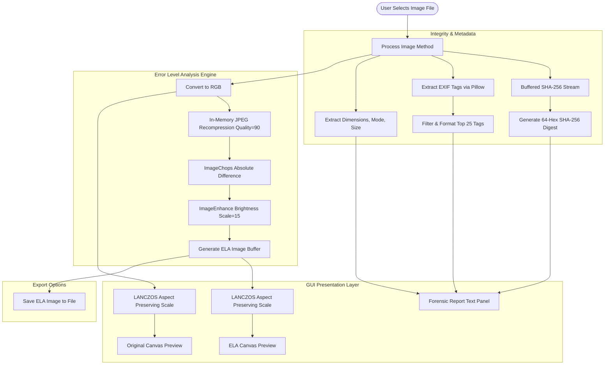
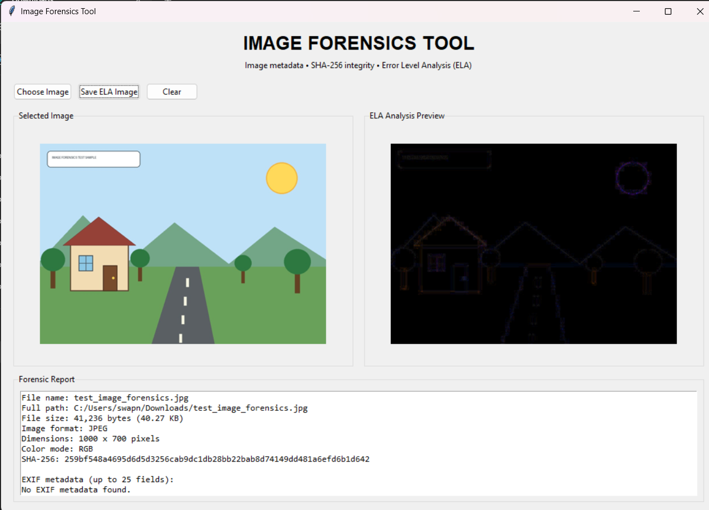

# Image Forensics Tool 🔍
### Design and Develop a Tool for Digital Forensic of Images

[](https://www.python.org/)
[](https://python-pillow.org/)
[](https://docs.python.org/3/library/tkinter.html)
[-purple.svg)]()
[]()

A standalone desktop application engineered in Python for first-level digital image forensics, evidence integrity hashing, EXIF metadata extraction, and Error Level Analysis (ELA) for image tampering detection.

---

## 📌 Academic Metadata

- **Course:** Laboratory Practice-IV (Cyber Security and Digital Forensics)
- **Course Code:** 410257
- **Student Name:** Shivshankar Mali
- **Roll No:** 49 &nbsp;|&nbsp; **Division:** C &nbsp;|&nbsp; **Semester:** VII
- **Academic Year:** 2026–2027
- **Faculty Guide:** Dr. Phadtare Tushar
- **Department:** Department of Computer Engineering
- **Institute:** JSPM's Bhivarabai Sawant Institute of Technology and Research, Wagholi, Pune

---

## 📖 Table of Contents
1. [Overview](#-overview)
2. [Key Capabilities & Features](#-key-capabilities--features)
3. [Forensic & Mathematical Methodology](#-forensic--mathematical-methodology)
   - [Error Level Analysis (ELA) Mechanics](#error-level-analysis-ela-mechanics)
   - [Cryptographic Integrity (SHA-256)](#cryptographic-integrity-sha-256)
   - [EXIF Metadata Extraction](#exif-metadata-extraction)
4. [Architecture & Workflow](#-architecture--workflow)
5. [Project Structure](#-project-structure)
6. [Prerequisites & Installation](#-prerequisites--installation)
7. [Usage Guide](#-usage-guide)
8. [Screenshots & Output Demonstration](#-screenshots--output-demonstration)
9. [Forensic Interpretation & Limitations](#-forensic-interpretation--limitations)
10. [References](#-references)

---

## 🔍 Overview

Digital images serve as pivotal evidence across criminal investigations, intelligence analysis, court proceedings, and cyber incident responses. However, contemporary editing software and generative modifications make unauthorized alterations (such as copy-move forgery, splicing, and metadata stripping) accessible and undetectable to the naked human eye.

The **Image Forensics Tool** was designed to provide forensic investigators, cybersecurity analysts, and students with an accessible, high-performance desktop application for initial digital triage. It allows rapid validation of:
- **File Provenance & Identity:** Format, dimensions, channel mode, and byte-size.
- **Data Integrity:** SHA-256 cryptographic hashes for chain-of-custody verification.
- **Provenance Clues:** Camera metadata, capture timestamps, and software signatures.
- **Compression Inconsistencies:** Error Level Analysis (ELA) to detect regions saved at differing compression ratios or spliced from other sources.

---

## 🚀 Key Capabilities & Features

| Feature | Description | Implementation Detail |
| :--- | :--- | :--- |
| **Dual-Pane Visualization** | Side-by-side rendering of the original evidence image and its enhanced ELA anomaly map. | High-quality LANCZOS aspect-ratio scaling inside responsive Tkinter canvases. |
| **Error Level Analysis (ELA)** | Identifies regions with varying compression history (e.g., pasted objects, altered text). | In-memory 90% JPEG recompression, pixel absolute subtraction, and $15\times$ brightness amplification. |
| **Cryptographic Integrity** | Generates an immutable digital fingerprint of the file. | Chunked 1 MB buffered streaming `hashlib.sha256` hashing to handle files of any size without memory spikes. |
| **EXIF Parsing** | Extracts camera parameters, dates, GPS pointers, and post-processing tools. | Resolves integer EXIF tags via `Pillow.ExifTags.TAGS` with intelligent value string truncating (up to 25 tags). |
| **Evidence Export** | Allows exporting the generated ELA diagnostic visualization for reports. | Saves lossless `.png` or compressed `.jpg` with automatic default naming (`<basename>_ela.png`). |
| **CLI & Direct Launch** | Supports interactive file picking as well as command-line argument launching. | `python app.py <path_to_image>` |

---

## 🔬 Forensic & Mathematical Methodology

### Error Level Analysis (ELA) Mechanics
JPEG is a lossy compression format based on the Discrete Cosine Transform (DCT) operating on $8 \times 8$ pixel blocks. Each subsequent save at a fixed quality factor decreases the amount of additional error introduced until the image reaches an error equilibrium.

When an external element (such as text or a foreign patch) is pasted into an image and resaved, that foreign region will experience an error rate different from the rest of the image.

The ELA algorithm executes as follows:
1. **Recompression:** The target image $I_{original}(x, y)$ is converted to RGB and saved to an in-memory byte buffer as JPEG with compression quality $Q = 90$:
   $$I_{recompressed} = \text{JPEG}_{Q=90}(I_{original})$$
2. **Absolute Difference Calculation:** The absolute per-pixel difference between the original and recompressed image is calculated:
   $$\Delta(x, y) = |I_{original}(x, y) - I_{recompressed}(x, y)|$$
3. **Brightness Scaling:** Because baseline compression differences are typically subtle ($0 \le \Delta \le 10$), the difference is magnified by a brightness factor $S = 15$:
   $$\text{ELA}(x, y) = \min\left(255, \Delta(x, y) \times S\right)$$

In the resulting display:
- **Uniform surfaces & edges:** Display consistent, predictable noise levels.
- **Tampered / spliced areas:** Glow substantially brighter or remain anomalously darker compared to neighboring blocks.

### Cryptographic Integrity (SHA-256)
Evidence handling requires maintaining strict chain of custody. The tool calculates a standard SHA-256 256-bit (64-character hexadecimal) message digest using a 1 MB chunk iterator:
$$\text{Digest} = \text{SHA-256}(\text{File\_Bytes})$$
Any single-bit modification to the evidence image permanently changes this hash.

### EXIF Metadata Extraction
Exchangeable Image File Format (EXIF) metadata stores camera make, model, shutter speed, aperture, focal length, software used (e.g., Adobe Photoshop, GIMP), and timestamps (`DateTimeOriginal`). The tool extracts raw tags and matches them against `ExifTags.TAGS` to expose forensic provenance.

---

## 🏗 Architecture & Workflow



---

## 📁 Project Structure

```
06_Mini_Project/
│
├── app.py                     # Main GUI desktop application (Tkinter + Pillow + hashlib)
├── requirements.txt           # Python dependencies (Pillow>=9.0.0)
├── test_image_forensics.jpg   # Sample image used for forensic testing & validation
├── main.tex                   # Academic LaTeX report source file
├── Mini_Project_Report.pdf    # Compiled technical mini project report
├── logo.png                   # College institution emblem
├── 1.png                      # Application screenshot (Forensic metadata inspection)
├── 2.png                      # Application screenshot (Error Level Analysis visualization)
└── README.md                  # Comprehensive project documentation
```

---

## 💻 Prerequisites & Installation

### 1. Prerequisites
- **Python 3.9+** (Tested on Python 3.9, 3.10, 3.11, 3.12)
- **Tkinter** (Standard with Python on Windows and macOS; on Linux install via `sudo apt install python3-tk`)

### 2. Setup Virtual Environment (Recommended)

Open PowerShell or terminal in the project directory:

```powershell
# Create a virtual environment
python -m venv venv

# Activate on Windows:
.\venv\Scripts\Activate.ps1

# (Or on Linux / macOS:)
# source venv/bin/activate
```

### 3. Install Required Dependencies

```powershell
pip install -r requirements.txt
```

*Note: `requirements.txt` specifies `Pillow>=9.0.0`.*

---

## 🖥 Usage Guide

### Launching the Application

1. **Standard GUI Launch:**
   ```powershell
   python app.py
   ```

2. **Direct Image Argument Launch:**
   ```powershell
   python app.py test_image_forensics.jpg
   ```

### Step-by-Step Forensic Workflow

1. **Open Image:** Click the **`Choose Image`** button on the top toolbar and select any standard image file (`.jpg`, `.jpeg`, `.png`, `.bmp`, `.tiff`, `.webp`).
2. **Review Image Data:**
   - Check the **Selected Image** canvas to verify the visual evidence.
   - Inspect the **Forensic Report** text area for file size, resolution dimensions, color mode, and SHA-256 hash.
3. **Examine EXIF Metadata:** Scroll through the forensic report panel to view embedded device parameters, timestamps, or software modification footprints.
4. **Inspect ELA Preview:** Observe the **ELA Analysis Preview** canvas. Look for brightness disparities, unexpected high-contrast noise patches, or sharper compression lines on supposedly smooth gradients.
5. **Export Anomaly Map:** Click **`Save ELA Image`** to store the rendered ELA diagnostic image (`.png` or `.jpg`) for case records and evidentiary documentation.
6. **Reset Workspace:** Click **`Clear`** to flush loaded buffers and reset all canvases.

---

## 🖼 Screenshots & Output Demonstration

### Application Interface & Metadata Report
The main interface displays side-by-side previews, file verification properties, and decoded EXIF tags:



### Error Level Analysis Result
Comparison highlight demonstrating the difference amplification in high-frequency versus uniform regions:


---

## ⚖ Forensic Interpretation & Limitations

> [!WARNING]
> Error Level Analysis (ELA) is a **preliminary screening heuristic**, not legally conclusive proof of digital manipulation.

When interpreting ELA findings:
1. **High-Frequency Edges:** Sharp edges, text overlays, and strong color contrasts naturally yield higher error levels due to high-frequency DCT quantization artifacts.
2. **Multiple Resaves:** Images re-saved multiple times will progressively lower their error level across the entire canvas.
3. **Aggressive Web Compression:** Platforms like WhatsApp, Instagram, and Twitter strip EXIF metadata and recompress images using proprietary algorithms, which can obscure tampering signatures.
4. **Corroborative Verification:** Always correlate ELA results with SHA-256 integrity, hex inspection, EXIF timeline consistency, and cross-channel color balance analysis.

---

## 📚 References

1. **Krawetz, N. (2007).** *A Picture's Worth: Digital Image Analysis and Forensics.* Black Hat Federal.
2. **Pillow Documentation:** *Python Imaging Library Handbook.* https://pillow.readthedocs.io/
3. **NIST Special Publication 800-86:** *Guide to Integrating Forensic Techniques into Incident Response.* National Institute of Standards and Technology.
4. **ExifTool by Phil Harvey:** *EXIF Tag Reference.* https://exiftool.org/TagNames/EXIF.html
5. **SPPU Computer Engineering Syllabus:** *Laboratory Practice-IV (CSDF) Curriculum (2019 Course).*
